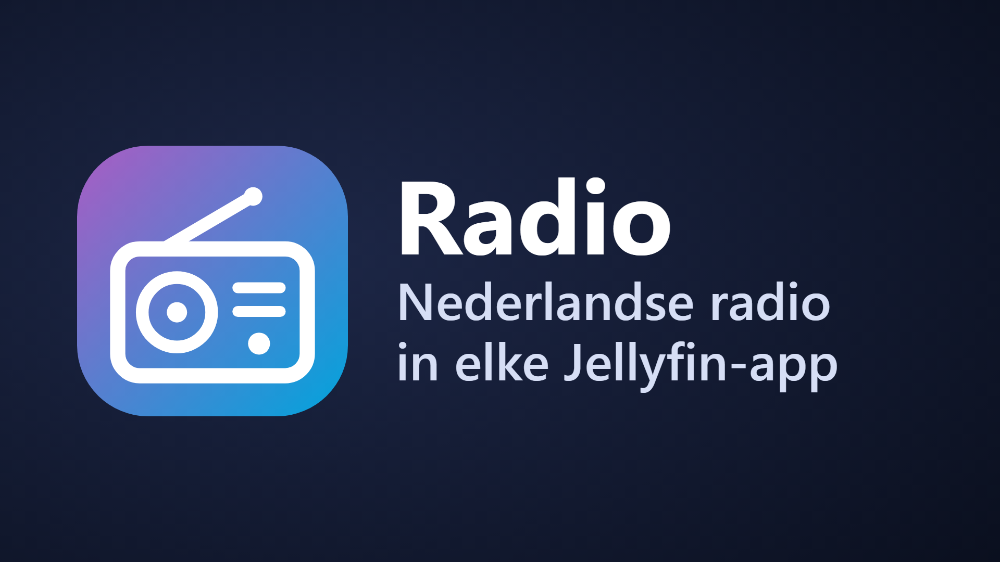
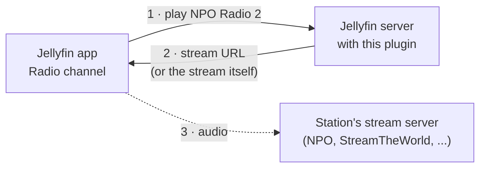

# Radio for Jellyfin

<p align="center"></p>

Listen to Dutch radio in the Jellyfin apps you already use: NPO Radio 1, 2, 3FM, Qmusic, Radio 538, Sky Radio, KINK, your regional
broadcaster and more. Stations play in Jellyfin's **music player**, with a play bar and lock-screen controls, not in a black video window.

> **Status: 0.0.1 test build** (a GitHub pre-release) to run the checks in [docs/SPIKES.md](docs/SPIKES.md). Version 0.1.0 follows once they pass.

## How it works

The plugin adds a **Radio** channel to Jellyfin (Home → My Media). Every station in it is a live audio item with one MP3 stream:



1. You open **Radio** in any Jellyfin app and pick a station. To Jellyfin it is just a song that never ends.
2. Jellyfin hands the app the station's stream. The web, Android and iOS apps get it through the Jellyfin server. Jellyfin Desktop and
   Chromecast fetch it from the station directly, and so does Android Auto unless you tick **Don't redirect apps to the station**.
3. Nothing is recorded or stored; the plugin only describes the stations.

Jellyfin's own [internet radio](https://jellyfin.org/docs/general/server/live-tv/internet-radio/) route (an M3U file in Live TV)
turns every station into a TV channel. It plays in the video player with a black screen, does not show up in Android Auto, and Sonos
refuses it. This plugin makes stations real audio items instead.

## Features

- **44 Dutch stations built in**, 33 switched on: NPO (Radio 1, 2, 3FM, Klassiek, 5, Blend, Sterren NL, FunX), national commercial stations
  (538, Qmusic, Sky Radio, Radio 10, Veronica, 100% NL, SLAM!, Sublime, KINK, Arrow, JOE, Decibel, BNR) and 12 regional public broadcasters.
  Every stream was checked and its format measured on 2026-10-13.
- **Your own stations.** Paste a stream URL, press **Test and add**: the plugin checks that it is a live MP3 stream and measures its format.
  StreamTheWorld node URLs are replaced by the stable redirect URL; playlists (.m3u, .pls) and AAC streams are refused with an explanation.
- **Edit freely.** Rename, reorder (the apps follow the page's order), change logos and stream URLs. Favourites and playlists survive,
  because a station's identity is its id, not its name or URL. Disabling or removing a station deletes its item, and with it its
  playlist entries; favourites come back if the same station returns within 90 days.
- **Diagnostics.** **Test** shows, for each station, the item and media source Jellyfin would serve, and which users cannot see the channel.

## Which apps

| App | Status |
|---|---|
| Jellyfin Web (browser) | Plays in the music player |
| Jellyfin Desktop / Media Player | Expected to work (being verified) |
| Jellyfin Android | Expected to work, including in the background (being verified) |
| Jellyfin for iOS | Expected to work (being verified). Swiftfin has no music player; use the Jellyfin app |
| Android TV | Not via the channel: the app plays only local audio files. A Live TV copy is planned |
| Android Auto | Planned via a "Radio" playlist (being verified) |
| Chromecast / Nest speakers | Being verified |
| Sonos via the DLNA plugin | Being verified |

## Requirements

- Jellyfin **12.2** or newer.
- Users need access to the channel: Dashboard → Users → *user* → Access → Channels (or "Enable access to all channels").
- "Force transcoding of remote media sources" must be off for those users: live radio cannot be transcoded.

## Install

Add this repository in Jellyfin → Dashboard → Plugins → Manage repositories, then install **Radio** and restart Jellyfin
(details in [SETUP.md](SETUP.md)):

```
https://raw.githubusercontent.com/SurfHost/jellyfin-plugin-radio/main/manifest.json
```

## Design

[docs/DESIGN.md](docs/DESIGN.md) explains every choice against Jellyfin 12.2's source code, such as why stations are MP3 only, why the
media source id is never a GUID and why renames need a sync pass.

## License

GPL-3.0. Station names and logos belong to their broadcasters; the plugin only links to their public streams and logos.
